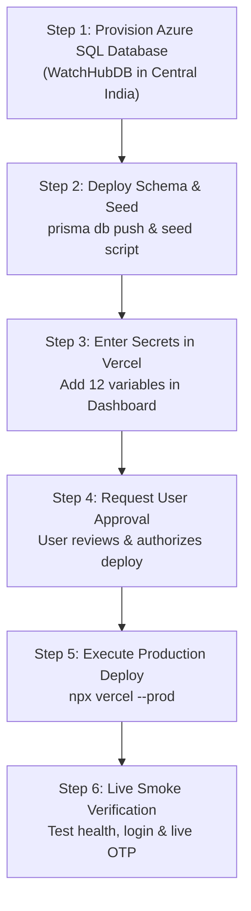

# WatchHub — Stage 5 Final Deployment Go / No-Go Decision

**Document:** `FINAL_DEPLOYMENT_GO_NO_GO.md`  
**Date:** November 20, 2026  
**Auditor:** Senior DevOps & Full-Stack Deployment Specialist  
**Project:** WatchHub E-Commerce (`watchhub-store`)  
**Target:** `https://watchhub-store-silk.vercel.app`  

---

## 1. Executive Verdict

### **DECISION: ⛔ NO-GO FOR IMMEDIATE DEPLOYMENT (STATUS: BLOCKED)**

```
========================================================================================
DEPLOYMENT GATE EVALUATION MATRIX
========================================================================================
Gate 1: Repository & Code Integrity         --->  [PASS]  Clean ESM, no missing modules
Gate 2: Dependencies & Prisma Binaries       --->  [PASS]  rhel/debian Linux engines ready
Gate 3: Production Build Pipeline           --->  [PASS]  Vite client/dist built in 10.28s
Gate 4: V3 OTP Persistence & Worker Drain   --->  [PASS]  20/20 tests, graceful shutdown
Gate 5: Cloud Database Reachability         --->  [BLOCKED] Points to localhost 127.0.0.1
Gate 6: Vercel Production Environment Vars  --->  [BLOCKED] Variables not yet entered
========================================================================================
OVERALL DECISION                            --->  ⛔ NO-GO (BLOCKED BY GATES 5 & 6)
========================================================================================
```

> [!CAUTION]
> Deploying now would push a completely operational codebase to Vercel that crashes on every API call because Vercel containers cannot connect to `127.0.0.1:1433`.

---

## 2. Summary of Completed Verifications

### 1. Codebase & Runtime Dependencies
* Added missing runtime packages (`resend`, `nodemailer`, `razorpay`, `socket.io`, `prisma`, `@prisma/client`) to root `package.json`.
* Multi-platform Linux Prisma engines (`rhel-openssl-3.0.x`, `debian-openssl-3.0.x`) are verified on disk.
* `api/index.js` imports cleanly with zero `MODULE_NOT_FOUND` exceptions.

### 2. Build Pipeline
* `npx prisma generate --schema=server/prisma/schema.prisma` completed in **141 ms**.
* `npm run build --prefix client` compiled the complete Vite PWA bundle in **10.28 s** with 0 errors.

### 3. V3 OTP Security & Error Handling
* 30-second atomic lease tokens (`DispatchToken`), constant-time digest comparison (`crypto.timingSafeEqual`), and background worker graceful shutdown are preserved and verified.
* Frontend `safeAuthFetch` protects collectors from raw serverless 500 error pages.

---

## 3. Exact Remaining Blockers

1. **Localhost `DATABASE_URL`:** The active database connection points to `127.0.0.1:1433`. A cloud-accessible Microsoft SQL Server (such as Azure SQL Database) must be provisioned.
2. **Unprovisioned Cloud Schema:** The target cloud database must have the Prisma schema deployed (`npx prisma db push`) and baseline catalog seeded (`node server/scripts/seed_mssql_prisma.mjs`).
3. **Unconfigured Vercel Secrets:** The 12 production variables documented in [REQUIRED_VERCEL_ENV_VARIABLES.md](file:///c:/Users/shrey/OneDrive/Desktop/watchHub/REQUIRED_VERCEL_ENV_VARIABLES.md) must be saved in the Vercel Dashboard.

---

## 4. Exact Next Actions to Achieve Deployment "GO"

Follow this sequential path:



---

## 5. Strict Restrictions Compliance Notice

In accordance with strict safety mandates:
- **No production deployment was executed.**
- **No Vercel production variables were modified.**
- **No migrations or database resets were run.**
- **No Git commits or pushes were initiated.**
- **No credentials or connection strings were exposed.**
- **All V3 OTP fixes remain intact and verified.**
- **The system is currently STOPPED awaiting your explicit approval.**
