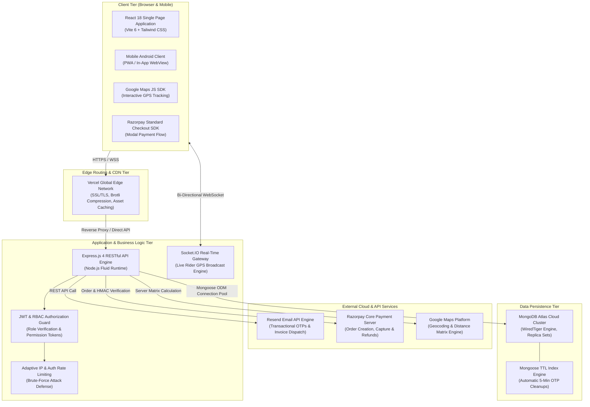

# WatchHub – Haute Horlogerie Luxury E-Commerce & Management Platform

[](https://watchhub-store-silk.vercel.app)
[](https://react.dev/)
[](https://www.typescriptlang.org/)
[](https://tailwindcss.com/)
[](https://nodejs.org/)
[](https://www.mongodb.com/)
[](https://razorpay.com/)
[](https://resend.com/)
[](https://socket.io/)

---

## 🌐 Live Production Deployments
- **Production Storefront & Operations Gateway**: [https://watchhub-store-silk.vercel.app](https://watchhub-store-silk.vercel.app)
- **Mobile Android Companion Application**: [WatchHub-latest.apk](https://watchhub-store-silk.vercel.app/downloads/WatchHub-latest.apk)

---

## 📖 Executive Summary & Horological Philosophy

**WatchHub** is an enterprise-grade luxury e-commerce ecosystem and horological supply-chain management platform designed specifically for the prestigious Swiss and international watchmaking industry.

Combining the refined visual elegance of Swiss Haute Horlogerie with a mission-critical full-stack architecture, WatchHub delivers:
- An ultra-fast, responsive storefront showcasing authenticated timepieces from world-renowned houses: **Rolex, Patek Philippe, Audemars Piguet, Omega, TAG Heuer, Breitling, Tissot, and Seiko**.
- An interactive **DIY 3D Beaded Watch Customization Studio** allowing customers to assemble bespoke movements, dials, bezels, and engraved casebacks.
- A **6-Role RBAC Operations Command Center** providing dedicated, isolated, professional portals for Store Administrators, Inventory Managers, Delivery Managers, Delivery Partner Riders, Customer Support Executives, and Connoisseur Customers.
- Production-grade third-party infrastructure: **Resend Email API** for cryptographic 6-digit OTP verification, **Razorpay Payment Gateway** with HMAC-SHA256 signature verification, and **Google Maps API + Socket.IO** for live real-time GPS courier telemetry.

---

## 🏛️ System Architecture & Multi-Tier Topology



---

## 👥 Six-Role Role-Based Access Control (RBAC) Matrix

WatchHub enforces strict authorization boundaries across six distinct user personas:

| User Role | Access Route | Dedicated Sidebar Modules & Capabilities | Primary Security Controls |
|:---|:---|:---|:---|
| **Store Admin** | `/admin/*` | **13 Modules**: Executive Dashboard, Product Catalog CRUD, Orders Management, In-Store POS Terminal, Inventory Synchronization, Delivery Operations, Customer Support Desk, Custom Watch Studio Approval, Offers & Coupons, Reports & Financial Analytics, System Settings & Audit Logs, Users Directory, Role Permissions. | Full system administrative privileges; MFA-protected; immutable audit logging. |
| **Inventory Manager** | `/inventory/*` | **11 Modules**: Vault Dashboard, Real-Time Stock Overview, Low-Stock Reorder Alerts, Stock Adjustments, Inter-Warehouse Movements, Purchase Orders, Vault Locations, Inventory Valuation Statements, Supplier Directories, Discrepancy Audits, Inventory Settings. | Scoped strictly to inventory and procurement schemas; zero customer PII access. |
| **Delivery Manager** | `/delivery/*` | **11 Modules**: Logistics Dashboard, Delivery Orders Queue, Smart Courier Assignment, Live Multi-Rider Radar, 3PL Partner Management, Google Route Planning, Delivery Exception Logs, Reverse Pickups & Returns, Geofenced Service Areas, Logistics Settings. | Restricted to fulfillment, shipping, and courier dispatch records. |
| **Delivery Partner (Rider)** | `/rider/*` | **4 Views**: Assigned Deliveries List, Live GPS Turn-by-Turn Navigation, Delivery Handover Verification (Customer OTP Code + Camera Proof of Delivery Upload), Earnings & Delivery History. | Scoped strictly to assigned active orders; location telemetry emission permissions. |
| **Customer Support Executive** | `/support/*` | **12 Modules**: Support Helpdesk Dashboard, Support Ticket Queues, Live Concierge WebSocket Chat, VIP Customer Directory, Orders & Returns Lookup, Razorpay Refunds & Replacements, Escalations Desk, Horology Knowledge Base, Canned Macro Responses, SLA Analytics, Team Permissions, Support Settings. | Scoped to customer inquiries and authorized refund triggers; read-only financial data. |
| **Customer / Connoisseur** | Storefront & `/orders/*` | Public Catalog Discovery, Faceted Filtering, DIY 3D Watch Customizer Studio, Shopping Bag, Razorpay Secure Checkout, My Orders & Live Tracking Canvas, Email OTP Authentication, Profile & Saved Address Book. | Standard customer isolation; can only access own orders, payments, and profile records. |

---

## 📂 Comprehensive Project Directory Structure

```
watchHub/
├── client/                               # Frontend Single Page Application (SPA)
│   ├── public/                           # Static production assets
│   │   ├── downloads/                    # Mobile APK builds (WatchHub-latest.apk)
│   │   ├── images/                       # High-res photography
│   │   │   ├── dashboards/               # Role dashboard visual assets
│   │   │   ├── hd_categories/            # High-definition category banners
│   │   │   └── products/                 # 100% authentic uncropped watch models
│   │   └── videos/                       # Mechanical watchmaking video preview files
│   ├── src/
│   │   ├── assets/                       # Bundled static images & SVG logos
│   │   ├── components/                   # Modular reusable UI components
│   │   │   ├── common/                   # Buttons, Badges, Modals, Breadcrumbs
│   │   │   ├── delivery/                 # Route planning modals, assign dialogs
│   │   │   ├── home/                     # Hero carousel, watchmaking video modal
│   │   │   ├── layout/                   # Global Navbar, Footer, Mobile Drawer
│   │   │   ├── orders/                   # Tracking stepper, milestone visualizer
│   │   │   ├── products/                 # Product cards, horological specs sheet
│   │   │   └── support/                  # Chat bubbles, ticket thread viewers
│   │   ├── context/                      # Global React State Contexts
│   │   │   ├── AuthContext.jsx           # JWT tokens, user role, RBAC claims
│   │   │   ├── CartContext.jsx           # Persistent cart, coupon engine
│   │   │   └── SocketContext.jsx         # Socket.IO connection & room listeners
│   │   ├── pages/                        # Main Application Route Views
│   │   │   ├── admin/                    # 13 Dedicated Store Admin Modules
│   │   │   ├── inventory/                # 11 Dedicated Inventory Manager Modules
│   │   │   ├── delivery/                 # 11 Dedicated Delivery Manager Modules
│   │   │   ├── support/                  # 12 Dedicated Customer Support Modules
│   │   │   ├── auth/                     # OTP Login, Email Register, Reset Password
│   │   │   ├── HomePage.jsx              # Luxury Horology Showcase
│   │   │   ├── WatchesPage.jsx           # Master catalog with faceted filters
│   │   │   ├── ProductDetailsPage.jsx    # Horology technical breakdown
│   │   │   ├── CustomizeWatchPage.jsx    # DIY 3D Watch Studio
│   │   │   ├── CartPage.jsx              # Shopping bag & tax calculations
│   │   │   ├── CheckoutPage.jsx          # Shipping selector & Razorpay modal
│   │   │   ├── CustomerOrdersTrackingPage.jsx # Order history
│   │   │   └── TrackParcelPage.jsx       # Google Maps live GPS telemetry view
│   │   ├── services/                     # Frontend API Client Wrappers (Axios)
│   │   ├── App.jsx                       # Master React Router V6 definitions
│   │   ├── index.css                     # Tailwind CSS & Horology design tokens
│   │   └── main.jsx                      # Application bootstrap entry point
│   ├── package.json                      # Frontend dependencies & Vite configuration
│   └── vite.config.js                    # Vite bundler configuration & proxy rules
│
├── server/                               # Backend RESTful & WebSocket API Engine
│   ├── src/
│   │   ├── config/                       # System Configurations
│   │   │   ├── db.js                     # Mongoose Atlas connection pool
│   │   │   └── razorpay.js               # Razorpay SDK client instance
│   │   ├── controllers/                  # Route business logic handlers
│   │   ├── middleware/                   # Express Middlewares
│   │   │   ├── auth.js                   # Bearer JWT verification & role validation
│   │   │   ├── rateLimiter.js            # Express-rate-limit security protection
│   │   │   └── validate.js               # Request payload validation
│   │   ├── models/                       # MongoDB Mongoose Data Schemas
│   │   │   ├── AuditLog.js               # Immutable administrative audit logs
│   │   │   ├── LocationHistory.js        # Time-series GPS coordinate logs
│   │   │   ├── Order.js                  # Master order & delivery lifecycle schema
│   │   │   ├── OtpVerification.js        # Hashed OTP store with 5-min TTL index
│   │   │   ├── Payment.js                # Razorpay transaction & refund schema
│   │   │   ├── Product.js                # Haute Horlogerie catalog & variant schema
│   │   │   └── User.js                   # User identity, address book & RBAC roles
│   │   ├── routes/                       # Express Route Groups
│   │   │   ├── authRoutes.js             # Email OTP register, login, password reset
│   │   │   ├── productRoutes.js          # Catalog search, filter, and CRUD
│   │   │   ├── paymentRoutes.js          # Razorpay order, HMAC verify, refund
│   │   │   ├── deliveryRoutes.js         # Logistics queue, courier dispatch, OTP
│   │   │   ├── trackingRoutes.js         # Telemetry ingestion, checkpoint updates
│   │   │   ├── inventoryRoutes.js        # Stock levels, adjustments, reorders
│   │   │   ├── supportRoutes.js          # Helpdesk tickets, live concierge chat
│   │   │   ├── customWatchRoutes.js      # Bespoke assembly component pricing
│   │   │   ├── dashboardRoutes.js        # Store Admin analytics KPIs
│   │   │   ├── userRoutes.js             # User directories & staff privileges
│   │   │   └── appUpdateRoutes.js        # Mobile OTA APK update versions
│   │   ├── services/                     # External Integration Services
│   │   │   ├── emailService.js           # Resend Email API client & HTML templates
│   │   │   ├── razorpayService.js        # Razorpay API client & webhook handlers
│   │   │   └── socketService.js          # Socket.IO room manager & GPS broadcaster
│   │   ├── app.js                        # Express middleware mounting & CORS config
│   │   └── server.js                     # HTTP & WebSocket server bootstrap
│   └── package.json                      # Backend dependencies & scripts
│
└── docs/                                 # Engineering Specifications & Academic Reports
    ├── API_Documentation.md              # Complete RESTful endpoint reference
    ├── Database_Dictionary.md            # Mongoose schema and data dictionary
    ├── System_Architecture.md            # Topology, security layers, and data flow
    ├── ER_Diagram.md                     # Entity-Relationship diagram & cardinality
    ├── DFD_Diagrams.md                   # Data Flow Diagrams (Level 0, 1, and 2)
    ├── UML_Diagrams.md                   # Use Case, Sequence, and Activity diagrams
    ├── TESTING.md                        # QA test matrix with pass/fail records
    ├── SCREENSHOTS.md                    # Visual screen registry and asset mapping
    ├── generate_report.py                # Academic PDF report generation engine
    └── WatchHub_Project_Report.pdf       # Comprehensive 15-Chapter Academic Report
```

---

## ⚡ Key Core Features

### 1. Resend Email OTP Verification System
- **Cryptographic OTP Generation**: 6-digit random code generated using secure entropy.
- **Bcrypt Hash Storage**: Plaintext OTP is never stored in the database; only a salted hash is persisted in `OtpVerification`.
- **Automatic TTL Expiration**: Native MongoDB TTL index automatically purges verification records after exactly 5 minutes (300 seconds).
- **Anti-Brute Force Protection**: Capped at 5 verification attempts; automatically invalidates code upon 5th failed attempt.
- **Email Delivery**: Dispatched using the official Resend API with luxury-styled HTML email templates.

### 2. Razorpay Production Payment Integration
- **Server-Side Order Generation**: Frontend never declares transaction amount; backend recomputes cart value against master database pricing.
- **HMAC-SHA256 Signature Verification**: Eliminates payment tampering by cryptographically verifying `razorpay_signature` using `crypto.createHmac`.
- **Atomic Stock Decrement**: Uses Mongoose conditional atomic operators to prevent race conditions during high-demand flash sales.
- **Direct Refund Dispatch**: Built-in support manager refund engine communicating directly with the Razorpay Refunds API.

### 3. Google Maps Platform & Real-Time GPS Telemetry
- **Google Maps JavaScript API**: High-precision interactive map rendering in customer tracking view.
- **Live WebSocket Telemetry**: Delivery riders emit GPS coordinates (`lat`, `lng`, `speed`, `heading`) which are broadcasted over dedicated Socket.IO rooms (`track_<orderId>`).
- **Doorstep Verification**: Delivery partners must enter the recipient's 6-digit delivery OTP and capture a photographic proof-of-delivery before an order can be marked `Delivered`.

### 4. DIY 3D Beaded Watch Customization Studio
- **Component Layering Engine**: Interactive visual compositor supporting cases (Titanium, Rose Gold, Platinum), dials (Sunburst, Guilloché, Skeleton), bezels (Ceramic, Diamond-set), and custom bead straps.
- **Caseback Engraving Engine**: Live engraving preview rendering custom text onto the timepiece caseback.
- **Dynamic Real-Time Pricing**: Automatic calculation of component costs and manufacturing surcharge.

---

## 🛠️ Technology Stack Matrix

| Layer | Technologies & Libraries | Purpose & Key Role |
|:---|:---|:---|
| **Frontend UI** | React 18, Vite 6, Tailwind CSS 3 | Fast Single Page Application, reactive state, responsive luxury UI |
| **Language** | JavaScript (ES Modules), TypeScript | Type safety for critical payment and map integrations |
| **Icons & Visuals** | Lucide React, Recharts | Horology glyphs, executive financial reporting charts |
| **Backend API** | Node.js (v18+ / v20+), Express.js 4 | RESTful API server, routing, controllers, security middleware |
| **Real-Time** | Socket.IO 4 | WebSocket server for low-latency live GPS rider tracking |
| **Database** | MongoDB Atlas, Mongoose 8 | Document database, schema validation, TTL indexes |
| **Authentication** | JSON Web Tokens (JWT), Bcrypt.js | Stateless session management, password encryption, 6-role RBAC |
| **Payment Gateway** | Razorpay Node.js SDK | UPI, Credit/Debit cards, Net Banking, HMAC signature verification |
| **Email Gateway** | Resend API SDK | Transactional Email OTP delivery, order confirmation receipts |
| **Maps & Location** | Google Maps JavaScript API | Geocoding, route rendering, distance and ETA calculations |
| **Security** | Helmet, Express-Rate-Limit, CORS | HTTP security headers, anti-DDoS, brute-force throttling |

---

## 🚀 Installation & Local Development Setup

### Prerequisites
- **Node.js**: v18.0.0 or higher
- **npm**: v9.0.0 or higher
- **MongoDB**: Local MongoDB instance or active MongoDB Atlas connection URI

### 1. Clone the Repository
```bash
git clone https://github.com/your-username/watchHub.git
cd watchHub
```

### 2. Configure Environment Variables

#### Backend Configuration (`server/.env`)
Create a file named `.env` in the `server/` directory:
```env
PORT=5000
NODE_ENV=development
CLIENT_URL=http://localhost:5173

# Database Connection
MONGODB_URI=mongodb+srv://<username>:<password>@cluster0.mongodb.net/watchhub?retryWrites=true&w=majority

# Authentication Secrets
JWT_SECRET=your_super_secret_jwt_access_token_key_here_2026
JWT_REFRESH_SECRET=your_super_secret_jwt_refresh_token_key_here_2026

# Email Integration (Resend API)
RESEND_API_KEY=re_your_resend_api_key_here
EMAIL_FROM=onboarding@resend.dev

# Payment Gateway (Razorpay)
RAZORPAY_KEY_ID=rzp_test_your_razorpay_key_id
RAZORPAY_KEY_SECRET=your_razorpay_key_secret

# Geolocation Services (Google Maps)
GOOGLE_MAPS_API_KEY=AIzaSy_your_google_maps_api_key_here
```

#### Frontend Configuration (`client/.env`)
Create a file named `.env` in the `client/` directory:
```env
VITE_API_BASE_URL=http://localhost:5000/api
VITE_SOCKET_URL=http://localhost:5000
VITE_RAZORPAY_KEY_ID=rzp_test_your_razorpay_key_id
VITE_GOOGLE_MAPS_API_KEY=AIzaSy_your_google_maps_api_key_here
```

### 3. Install Dependencies & Seed Database
```bash
# Install Server Dependencies
cd server
npm install

# Seed Initial Watch Catalog & Staff Accounts
npm run seed

# Install Client Dependencies
cd ../client
npm install
```

### 4. Run the Development Servers
In two separate terminal windows:

```bash
# Terminal 1: Run Backend API & WebSocket Engine
cd server
npm run dev

# Terminal 2: Run Frontend Vite Dev Server
cd client
npm run dev
```
Open [http://localhost:5173](http://localhost:5173) in your browser to experience WatchHub.

---

## 🧪 Comprehensive Technical Documentation Suite

Detailed architectural documents, engineering diagrams, and academic reports are located in the `docs/` directory:

1. **[docs/System_Architecture.md](file:///c:/Users/shrey/OneDrive/Desktop/watchHub/docs/System_Architecture.md)**: Architectural diagrams, security zones, and Socket.IO protocol specifications.
2. **[docs/ER_Diagram.md](file:///c:/Users/shrey/OneDrive/Desktop/watchHub/docs/ER_Diagram.md)**: Entity-Relationship diagram, cardinality definitions, and MongoDB indexing strategies.
3. **[docs/Database_Dictionary.md](file:///c:/Users/shrey/OneDrive/Desktop/watchHub/docs/Database_Dictionary.md)**: Tabular schema dictionary for all 7 Mongoose collections and embedded subdocuments.
4. **[docs/API_Documentation.md](file:///c:/Users/shrey/OneDrive/Desktop/watchHub/docs/API_Documentation.md)**: RESTful API reference specifications with request and response payloads.
5. **[docs/DFD_Diagrams.md](file:///c:/Users/shrey/OneDrive/Desktop/watchHub/docs/DFD_Diagrams.md)**: Data Flow Diagrams (Context Level 0, Level 1, and Level 2 Decomposition).
6. **[docs/UML_Diagrams.md](file:///c:/Users/shrey/OneDrive/Desktop/watchHub/docs/UML_Diagrams.md)**: Role-wise Use Case diagrams, Sequence diagrams (OTP, Razorpay, GPS), and Activity flows.
7. **[docs/TESTING.md](file:///c:/Users/shrey/OneDrive/Desktop/watchHub/docs/TESTING.md)**: Formal QA test matrix covering 24 test cases across functional and security suites.
8. **[docs/SCREENSHOTS.md](file:///c:/Users/shrey/OneDrive/Desktop/watchHub/docs/SCREENSHOTS.md)**: UI screen gallery and asset registry.
9. **[WatchHub_Project_Report.pdf](file:///c:/Users/shrey/OneDrive/Desktop/watchHub/WatchHub_Project_Report.pdf)**: 15-Chapter Academic & Software Engineering Project Report.

---

## 📄 License & Intellectual Property
Developed for **WatchHub Luxury Horology International**. Distributed under the Proprietary Commercial License. Unauthorized reproduction, modification, or distribution of this source code or horological assets is strictly prohibited.
