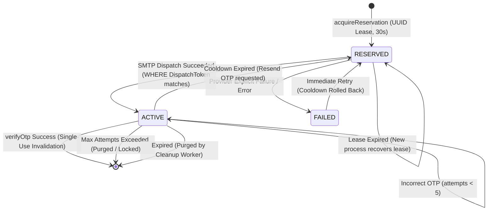

# V3 DISPATCH STATE MACHINE SPECIFICATION

### State Diagram

---

### Detailed State Transition Table

| Current State | Event / Trigger | Preconditions | Target State | DB Transition Logic | User / Client Outcome |
|---|---|---|---|---|---|
| **NONE** | Initial OTP Request | No active record exists | `RESERVED` | `INSERT INTO OTPVerifications (..., DispatchState='RESERVED', DispatchLockedUntil=now+30s)` | Lease acquired, email dispatch begins. |
| **RESERVED** | Concurrent Request | `DispatchLockedUntil > now` | `RESERVED` | Rejected (No DB write) | HTTP 429 (`inFlight: true`). Concurrent dispatch rejected. |
| **RESERVED** | Lease Expired | `DispatchLockedUntil <= now` | `RESERVED` | `UPDATE ... SET DispatchToken=@newToken WHERE DispatchLockedUntil <= now` | New process recovers stale lease; old process dispossessed. |
| **RESERVED** | SMTP Dispatch OK | `DispatchToken` matches | `ACTIVE` | `UPDATE ... SET DispatchState='ACTIVE' WHERE DispatchToken=@token` | Code is now verifiable. 60s cooldown enforced. |
| **RESERVED** | Late SMTP Completion | `DispatchToken` mismatch | `NOOP` | `WHERE DispatchToken=@token` affects 0 rows | Old process drops out cleanly. Newer code preserved. |
| **RESERVED** | Provider Rejection | `DispatchToken` matches | `FAILED` | `UPDATE ... SET DispatchState='FAILED', ResendCooldownUntil=now WHERE DispatchToken=@token` | Immediate retry allowed; no lockout penalty. |
| **ACTIVE** | Resend Request | `ResendCooldownUntil > now` | `ACTIVE` | Rejected (No DB write) | HTTP 429 rate limit (`waitSeconds` returned). |
| **ACTIVE** | Resend Request | `ResendCooldownUntil <= now` | `RESERVED` | Atomic transition with new `DispatchToken` | New OTP generated and dispatched. |
| **ACTIVE** | Valid OTP Verification | `ExpiresAt > now` & `attempts < 5` | **PURGED** | `UPDATE ... SET IsVerified=1, DispatchState='FAILED' WHERE ...; DELETE` | Session authenticated; single-use consumption guaranteed. |
| **ACTIVE** | Invalid OTP Verification | `attempts < 4` | `ACTIVE` | `UPDATE ... SET Attempts = Attempts + 1` | HTTP 400 error with remaining attempts. |
| **ACTIVE** | 5th Failed Attempt | `attempts == 4` | **PURGED** | `DELETE FROM OTPVerifications` | HTTP 400 locked (`Maximum verification attempts exceeded`). |
| **ACTIVE** | Expiration | `ExpiresAt <= now` | **PURGED** | Deleted by `OtpCleanupWorker` batch query | Verification rejected (`expired: true`). |
