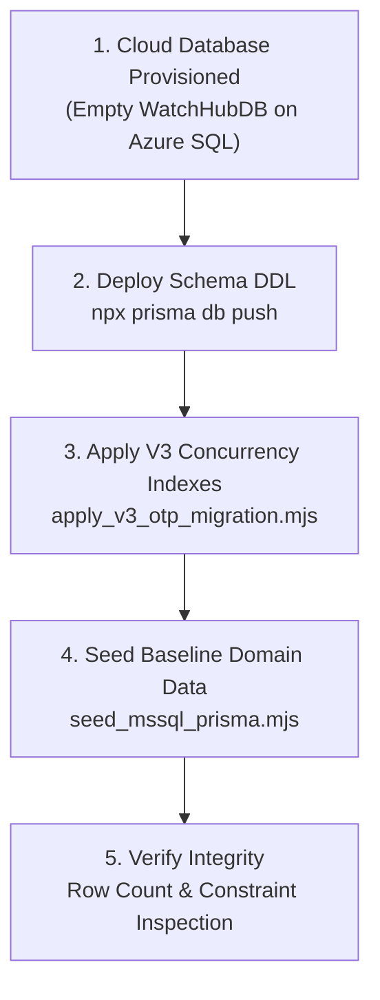

# WatchHub — Schema & Data Migration Runbook

**Document:** `WATCHHUB_CLOUD_DATABASE_MIGRATION_PLAN/04_SCHEMA_AND_DATA_MIGRATION_RUNBOOK.md`  
**Date:** November 20, 2026  
**Auditor:** Senior DevOps & Prisma Database Specialist  
**Execution Scope:** Forward-only, non-destructive cloud database provisioning and data seeding.

---

## 1. Migration Methodology Overview

WatchHub utilizes a reproducible, Prisma-driven forward migration strategy:



---

## 2. Step-by-Step Execution Runbook

### Step 1: Secure Cloud Database Connection String
After provisioning the Azure SQL Database in Azure Portal, construct the connection string:

```text
DATABASE_URL="sqlserver://<your-server>.database.windows.net:1433;database=WatchHubDB;user=watchhub_admin;password=<YOUR_SECURE_PASSWORD>;encrypt=true;trustServerCertificate=false"
```

Save this string in a temporary local file `.env.cloud_migrate` (add this file to `.gitignore` so it is never committed).

---

### Step 2: Push Prisma Schema to Cloud Database
Deploy the complete 24-table relational schema using Prisma's schema push engine:

```powershell
# Set temporary cloud connection environment variable
$env:DATABASE_URL="sqlserver://<your-server>.database.windows.net:1433;database=WatchHubDB;user=watchhub_admin;password=<YOUR_SECURE_PASSWORD>;encrypt=true;trustServerCertificate=false"

# Push schema directly to the cloud database
npx prisma db push --schema=server/prisma/schema.prisma
```

#### What this accomplishes:
- Connects to the cloud SQL Server over TLS.
- Creates all 22 domain tables (`Roles`, `Permissions`, `RolePermissions`, `Users`, `UserRoles`, `Addresses`, `Products`, `Categories`, `Brands`, `Inventory`, `Orders`, `OrderItems`, `OTPVerifications`, `Payments`, `Deliveries`, `Warehouses`, etc.).
- Establishes all foreign key constraints and cascading delete rules.
- Creates clustered primary key indexes.

---

### Step 3: Apply V3 Distributed OTP Concurrency Indexes
The V3 OTP persistence architecture relies on compound unique constraints and cleanup indexes that optimize high-concurrency locking and zero-table-scan background purges.

Run the migration script against the cloud database:

```powershell
node server/scripts/apply_v3_otp_migration.mjs
```

#### Verified DDL Applied:
1. `UQ_OTPVerifications_Identifier_Purpose`: Compound unique index on `[Identifier, Purpose]`.
2. `IX_OTP_ExpiresAt`: Nonclustered index on `[ExpiresAt]`.
3. `IX_OTP_DispatchLockedUntil`: Nonclustered index on `[DispatchLockedUntil]`.
4. Columns: Ensures `DispatchToken` (NVarChar 64), `DispatchState` (NVarChar 20), and `DispatchLockedUntil` (DateTime2) exist.

---

### Step 4: Seed Baseline Domain Data
Populate core configuration, administrative roles, permissions, and initial timepiece inventory:

```powershell
node server/scripts/seed_mssql_prisma.mjs
```

#### Seeded Datasets Created:
- **7 System Roles:** `Super Admin`, `Store Admin`, `Inventory Manager`, `Delivery Manager`, `Support Executive`, `Customer`, `Guest`.
- **21 System Permissions:** Full CRUD and granular operational capabilities.
- **Role-Permission Mappings:** 22 relations established.
- **Administrative & Staff Accounts:** 9 pre-configured accounts with secure bcrypt-hashed passwords.
- **Catalog Taxonomies:** 8 watch categories, 28 luxury brands, 33 luxury watch models, and warehouse inventory records.

---

## 3. Post-Migration Parity Verification

Run the non-destructive verification query against the cloud database:

```powershell
node -e "
import dotenv from 'dotenv';
dotenv.config({ path: './.env.cloud_migrate' });
import('./server/src/config/prisma.js').then(async ({ prisma }) => {
  const users = await prisma.user.count();
  const roles = await prisma.role.count();
  const products = await prisma.product.count();
  const categories = await prisma.category.count();
  const brands = await prisma.brand.count();
  console.log('--- CLOUD DB SEED VERIFICATION ---');
  console.log({ users, roles, products, categories, brands });
  process.exit(0);
}).catch(err => { console.error(err); process.exit(1); });
"
```

### Expected Post-Migration Verification Values:
- `users`: $\ge 9$
- `roles`: `7`
- `products`: `33`
- `categories`: `8`
- `brands`: `28`

Once verified, delete `.env.cloud_migrate` immediately to prevent secret leakage.
