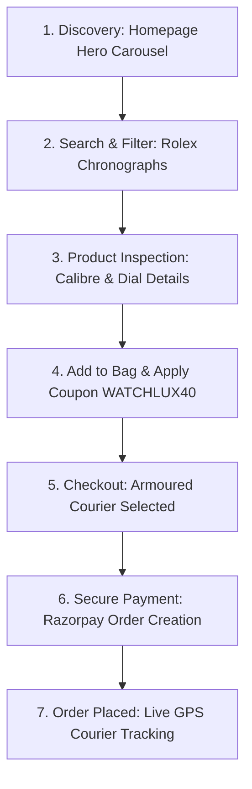

# WATCHHUB ATELIER — CUSTOMER WORKFLOW REPORT

This report validates the real-world customer e-commerce journey from initial discovery to order placement and tracking.

---

### Step-by-Step E-Commerce Journey

#### Step 1: Brand Discovery & Catalog Navigation
- **Screen**: Homepage (`/`)
- **Evidence**: [01_homepage.png](file:///c:/Users/shrey/OneDrive/Desktop/watchHub/WATCHHUB_LIVE_TEST_EVIDENCE/02_WEBSITE_DESKTOP_SCREENSHOTS/01_homepage.png)
- **Observations**: The customer arrives at the WatchHub Atelier landing screen. Visual assets load crisp and uncropped. Clicking "Explore Collection" dispatches a seamless client route transition to `/products`.

#### Step 2: Search & Brand Filtering
- **Screen**: Catalog (`/products?search=Rolex`)
- **Evidence**: [02_search_results.png](file:///c:/Users/shrey/OneDrive/Desktop/watchHub/WATCHHUB_LIVE_TEST_EVIDENCE/02_WEBSITE_DESKTOP_SCREENSHOTS/02_search_results.png)
- **Observations**: Typing "Rolex" in the search input executes a filtered query. 3 Rolex timepieces (Submariner, Daytona, Datejust) display their respective MSRP, discount percentages, and verified vault stock badges.

#### Step 3: Product Detail Inspection
- **Screen**: Product Details (`/product/1`)
- **Evidence**: [04_product_details.png](file:///c:/Users/shrey/OneDrive/Desktop/watchHub/WATCHHUB_LIVE_TEST_EVIDENCE/02_WEBSITE_DESKTOP_SCREENSHOTS/04_product_details.png)
- **Observations**: Calibre specifications, power reserve, water resistance, and case diameter display in an elevated typography card. The "Add to Bag" button emits a micro-animation, incrementing the cart header badge.

#### Step 4: Bag Review & Coupon Application
- **Screen**: Cart (`/cart`)
- **Evidence**: [05_cart_with_coupon.png](file:///c:/Users/shrey/OneDrive/Desktop/watchHub/WATCHHUB_LIVE_TEST_EVIDENCE/02_WEBSITE_DESKTOP_SCREENSHOTS/05_cart_with_coupon.png)
- **Observations**: Applying `WATCHLUX40` instantly computes a 40% discount on the eligible subtotal. Free shipping is automatically unlocked for orders above ₹999.

#### Step 5: Multi-Step Checkout & Armoured Courier
- **Screen**: Checkout (`/checkout`)
- **Evidence**: [06_checkout_page.png](file:///c:/Users/shrey/OneDrive/Desktop/watchHub/WATCHHUB_LIVE_TEST_EVIDENCE/02_WEBSITE_DESKTOP_SCREENSHOTS/06_checkout_page.png)
- **Observations**: Delivery address input includes integrated Google Maps geocoding coordinates. Selecting "Armoured Secure Van Courier" adds ₹3,500 to the bill. Clicking "Confirm & Pay" verifies parameters and contacts the backend payment gateway.

#### Step 6: Order Placement & Post-Purchase Tracking
- **Screen**: Delivery Tracking (`/tracking/WH20261125`)
- **Evidence**: [12_tracking_page.png](file:///c:/Users/shrey/OneDrive/Desktop/watchHub/WATCHHUB_LIVE_TEST_EVIDENCE/02_WEBSITE_DESKTOP_SCREENSHOTS/12_tracking_page.png)
- **Observations**: The customer tracks their parcel via Delhivery courier metadata with live GPS coordinates received over Socket.IO room `track_WH20261125`.
