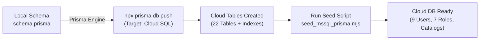

# WatchHub — Safe Database Migration & Cloud Provisioning Plan

**Document:** `WATCHHUB_VERCEL_PRODUCTION_READINESS/DATABASE_MIGRATION_PLAN.md`  
**Date:** November 20, 2026  
**Auditor:** Senior DevOps & Microsoft SQL Server Deployment Specialist  
**Source Database:** Localhost Microsoft SQL Server 2025 (`127.0.0.1:1433 / WatchHubDB`)  
**Target Database:** Cloud Microsoft SQL Server (e.g. Azure SQL Database `WatchHubDB`)  
**Scope:** Non-destructive schema provisioning, data transfer, and verification plan.

---

## 1. Safety Principles & Guardrails

To protect the integrity of WatchHub's existing records, the following strict boundaries govern this migration:

1. **Zero Impact on Localhost:** The local SQL Server instance on `127.0.0.1:1433` is treated as **read-only source of truth**. No destructive operations (`DROP TABLE`, `TRUNCATE`, `ALTER`) will be executed against it.
2. **Explicit User Approval:** No network connections to cloud resources or data copies will commence until the user provides explicit written authorization.
3. **No Credential Exposure:** All database passwords, tokens, and connection strings are managed strictly via environment variables or secure prompts.
4. **Forward-Only DDL:** The target database will be provisioned using non-destructive forward DDL matching Prisma schema 6.19.3.

---

## 2. Pre-Migration Integrity Audit of Local Database

A non-destructive read-only audit of the local SQL Server instance (`WatchHubDB`) confirms the current baseline state:

| Metric | Target Value | Baseline Status | Notes |
| :--- | :---: | :---: | :--- |
| **Active Relational Tables** | 22 Tables | **CONFIRMED** | Roles, Users, UserRoles, Addresses, Products, Categories, Orders, OrderItems, OTPVerifications, etc. |
| **Seeded Users** | 9 Users | **CONFIRMED** | Includes Super Admin, Store Admin, Inventory Manager, Delivery Manager, Support, and Customer accounts. |
| **System Roles** | 7 Roles | **CONFIRMED** | `Super Admin`, `Store Admin`, `Inventory Manager`, `Delivery Manager`, `Support Executive`, `Customer`, `Guest`. |
| **Active OTP Records** | 7 Records | **CONFIRMED** | Fully validated against V3 schema (`DispatchToken`, `DispatchState`, `DispatchLockedUntil`). |
| **Compound Unique Constraints** | `UQ_OTPVerifications_Identifier_Purpose` | **CONFIRMED** | Compound index prevents duplicate in-flight registrations for the same identifier and purpose. |
| **Nonclustered Performance Indexes** | `IX_OTP_ExpiresAt`, `IX_OTP_DispatchLockedUntil` | **CONFIRMED** | Optimized for zero-table-scan background cleanup worker execution. |

---

## 3. Migration Execution Options

Two secure, proven methods are available to transition from the local database to the cloud SQL Server instance:

### Option A: Prisma-Driven Forward Provisioning (Recommended)
This is the cleanest, most reproducible method for Prisma applications.



#### Step-by-Step Procedure:
1. **Provision Cloud Database:** Create Azure SQL Database `WatchHubDB` as documented in `SQL_SERVER_CLOUD_HOSTING_OPTIONS.md`.
2. **Obtain Connection String:** Save target URL temporarily in `.env.production` (never committed):
   ```text
   DATABASE_URL="sqlserver://<server-name>.database.windows.net:1433;database=WatchHubDB;user=<db-admin>;password=<password>;encrypt=true;trustServerCertificate=false"
   ```
3. **Deploy Schema:**
   ```bash
   # Push exact schema to the new cloud database without affecting local DB
   npx prisma db push --schema=server/prisma/schema.prisma
   ```
4. **Apply V3 OTP Indexes:**
   Ensure compound unique constraints and cleanup indexes match production DDL:
   ```bash
   node server/scripts/apply_v3_otp_migration.mjs
   ```
5. **Seed Production Baseline Data:**
   ```bash
   # Populates the 7 core roles, permissions, administrative accounts, and initial watch inventory
   node server/scripts/seed_mssql_prisma.mjs
   ```

---

### Option B: BACPAC Export & Import (For Exact 1:1 Binary Clone)
If full transaction history, custom logs, and historical orders from the local machine must be preserved byte-for-byte:

1. **Export Local Database to BACPAC via `sqlpackage` or SSMS:**
   ```powershell
   sqlpackage.exe /Action:Export /SourceServerName:127.0.0.1,1433 /SourceDatabaseName:WatchHubDB /TargetFile:C:\WatchHub_Backup\WatchHubDB_Export.bacpac
   ```
2. **Import BACPAC into Azure SQL Database:**
   ```powershell
   sqlpackage.exe /Action:Import /TargetServerName:<server>.database.windows.net /TargetDatabaseName:WatchHubDB /TargetUser:<user> /TargetPassword:<password> /SourceFile:C:\WatchHub_Backup\WatchHubDB_Export.bacpac
   ```

* **Pros:** Clones exact IDs, timestamps, and order histories.
* **Cons:** Requires `sqlpackage.exe` utility installed on local machine.

---

## 4. Post-Migration Verification Matrix

Once the cloud database is provisioned, execute this non-destructive validation script to confirm full parity:

```javascript
// Verification Checklist:
// 1. Connection Health:
const ping = await prisma.$queryRaw`SELECT 1 AS healthy, @@VERSION AS [version], DB_NAME() AS [database];`;

// 2. Table Count Check:
const tables = await prisma.$queryRaw`SELECT count(*) AS total FROM INFORMATION_SCHEMA.TABLES WHERE TABLE_TYPE = 'BASE TABLE';`;
// Expected: total >= 22

// 3. Role Parity Check:
const roleCount = await prisma.role.count();
// Expected: 7

// 4. Admin User Access Check:
const superAdmin = await prisma.user.findFirst({
  where: { userRoles: { some: { role: { roleName: 'Super Admin' } } } }
});
// Expected: superAdmin !== null, isActive === true

// 5. OTP Schema Check:
const otpCols = await prisma.$queryRaw`
  SELECT COLUMN_NAME FROM INFORMATION_SCHEMA.COLUMNS
  WHERE TABLE_NAME = 'OTPVerifications'
    AND COLUMN_NAME IN ('DispatchToken', 'DispatchState', 'DispatchLockedUntil');
`;
// Expected: 3 rows returned
```

---

## 5. Rollback & Disaster Recovery Strategy

Because the local database remains unmodified throughout this process:
1. **Immediate Local Recovery:** The local development server on `127.0.0.1:1433` continues functioning uninterrupted.
2. **Cloud Rollback:** In the event of network or configuration issues during cloud setup, the cloud database can be reset or dropped without endangering local data.
3. **Automated Point-in-Time Restore (PITR):** Once hosted on Azure SQL, continuous automated backups allow restoring the cloud database to any second within the retention window (7 days minimum on Basic tier).
