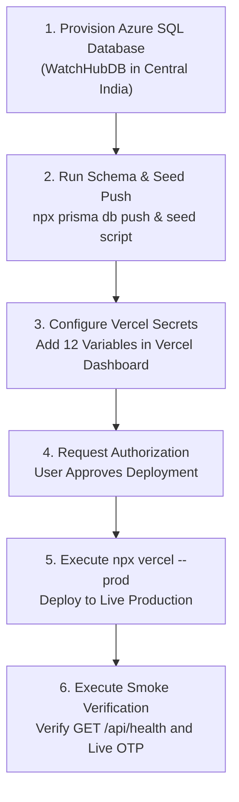

# WatchHub — Final Go / No-Go Production Readiness Report

**Document:** `WATCHHUB_VERCEL_PRODUCTION_READINESS/FINAL_GO_NO_GO_REPORT.md`  
**Date:** November 20, 2026  
**Auditor:** Senior DevOps Engineer, Node.js Backend Architect & SQL Server Deployment Engineer  
**Live Target:** `https://watchhub-store-silk.vercel.app` (`watchhub-store`)  
**Scope:** Final Comprehensive Production Readiness Decision and Blocker Analysis.

---

## 1. Executive Verdict

### **DECISION: ⛔ NO-GO FOR IMMEDIATE PRODUCTION DEPLOYMENT**

> [!CAUTION]
> **Production Gate Status: BLOCKED BY CLOUD INFRASTRUCTURE & CREDENTIALS**  
> While all local code, automated test suites (20/20 V3 OTP, 8/8 Auth, 15/15 Android), and frontend build artifacts are in a **100% READY** state, deploying to Vercel immediately will result in an immediate `HTTP 500` outage because:
> 1. Vercel's serverless containers cannot connect to the local SQL Server at `127.0.0.1:1433`.
> 2. The required production secrets (`DATABASE_URL`, `JWT_...`, `OTP_...`, `GMAIL_...`) have not yet been configured in the Vercel Dashboard.
>
> **Deploying now would replace the existing live site with a deployment that fails on all database operations.**

---

## 2. Current Project Health Assessment

| Subsystem | Audit Status | Health Detail |
| :--- | :---: | :--- |
| **Codebase & Syntax** | **HEALTHY** | Node.js ESM modules import cleanly; Express 4.21.2 setup verified. |
| **Backend Dependencies** | **HEALTHY** | Root `package.json` contains `resend`, `nodemailer`, `razorpay`, `socket.io`, `prisma`. |
| **Prisma Engine Binaries** | **HEALTHY** | Multi-target Linux query engines (`rhel-openssl-3.0.x`, `debian-openssl-3.0.x`) verified on disk. |
| **Frontend Production Build** | **HEALTHY** | Vite bundle in `client/dist` compiles in 12.04 seconds with zero errors. |
| **V3 OTP Persistence** | **HEALTHY** | Distributed lease tokens, atomic state transitions, timing-safe compare, and drain worker verified. |
| **Automated Test Matrix** | **HEALTHY** | **20/20** V3 OTP tests passed, **8/8** full auth tests passed, **15/15** native Android unit tests passed. |
| **Local Database State** | **HEALTHY** | Microsoft SQL Server 2025 on `127.0.0.1:1433` populated with 22 tables, 9 users, 7 roles. |
| **Vercel Cloud Reachability** | **UNHEALTHY** | Vercel containers in AWS Mumbai cannot reach `127.0.0.1:1433`. |
| **Vercel Project Secrets** | **MISSING** | Production environment variables not yet populated in Vercel settings. |

---

## 3. Inventory of Missing Environment Variables in Vercel

The following variables must be added to the Vercel Project Settings (`watchhub-store`) before deploying:

```text
[CRITICAL - REQUIRED FOR STARTUP & DATABASE]
DATABASE_URL                 -> Cloud SQL Server connection string with encrypt=true;trustServerCertificate=false
NODE_ENV                     -> production

[CRITICAL - REQUIRED FOR AUTHENTICATION & SECURITY]
JWT_ACCESS_SECRET            -> 64-character hex cryptographic secret (1h access tokens)
JWT_REFRESH_SECRET           -> 64-character hex cryptographic secret (7d refresh tokens)
OTP_HASH_SECRET_CURRENT      -> 64-character hex dedicated HMAC secret (V3 OTP storage)

[HIGH - REQUIRED FOR EMAIL OTP DELIVERY]
GMAIL_USER                   -> Primary sender Gmail address (e.g. your-email@gmail.com)
GMAIL_APP_PASSWORD           -> 16-character Google App Password (spaces stripped automatically)
RESEND_API_KEY               -> Secondary fallback API key (re_...)
EMAIL_FROM                   -> Sender string ("WatchHub Atelier <onboarding@resend.dev>")

[MEDIUM - REQUIRED FOR PAYMENTS ONLY]
RAZORPAY_KEY_ID              -> Live/Test Razorpay Key ID
RAZORPAY_KEY_SECRET          -> Live/Test Razorpay Secret Key
CLIENT_URL                   -> https://watchhub-store-silk.vercel.app
```

*Detailed generation and procurement steps are provided in [VERCEL_ENV_SETUP_GUIDE.md](file:///c:/Users/shrey/OneDrive/Desktop/watchHub/WATCHHUB_VERCEL_PRODUCTION_READINESS/VERCEL_ENV_SETUP_GUIDE.md).*

---

## 4. Recommended Cloud SQL Server Hosting Solution

### **Recommendation: Azure SQL Database (Serverless or Basic Tier)**

* **Why Azure SQL:**
  1. **Direct Microsoft Support:** Native compatibility with Microsoft SQL Server 2025 T-SQL, compound unique keys, and temporal tables.
  2. **Trusted Public TLS Certificate:** Validated against Microsoft IT Root CA, allowing `encrypt=true;trustServerCertificate=false` (zero self-signed security warnings).
  3. **Free Tier / Low Cost:** Eligible for 100,000 vCore seconds/month free for 12 months with Azure Free Account, or **$5.00/month** for a dedicated Basic tier (5 DTU, 2 GB).
  4. **Sub-15ms Latency:** Provisioning in `Central India` (Pune) or `South India` (Chennai) ensures rapid communication with Vercel's Mumbai (`bom1`) containers.

*Detailed provisioning, firewall, and connection instructions are provided in [SQL_SERVER_CLOUD_HOSTING_OPTIONS.md](file:///c:/Users/shrey/OneDrive/Desktop/watchHub/WATCHHUB_VERCEL_PRODUCTION_READINESS/SQL_SERVER_CLOUD_HOSTING_OPTIONS.md).*

---

## 5. Exact Next Steps for Deployment Execution

Follow this sequential procedure once ready:



1. **Step 1: Provision Azure SQL Database**
   - Create `WatchHubDB` on Azure SQL.
   - Configure firewall to allow Azure services and your current client IP.
2. **Step 2: Deploy Schema to Cloud Database**
   - Push schema non-destructively: `npx prisma db push --schema=server/prisma/schema.prisma`.
   - Seed baseline roles, permissions, and initial catalog: `node server/scripts/seed_mssql_prisma.mjs`.
3. **Step 3: Populate Vercel Dashboard Environment Variables**
   - Open `https://vercel.com/13shreyayadav/watchhub-store/settings/environment-variables`.
   - Enter all 12 variables documented in the guide.
4. **Step 4: Await Explicit Approval**
   - Confirm cloud database connectivity and secret configuration before requesting authorization.
5. **Step 5: Run Production Deployment**
   - Run `npx vercel --prod` to deploy verified code.
6. **Step 6: Run Smoke Tests**
   - Follow [DEPLOYMENT_CHECKLIST.md](file:///c:/Users/shrey/OneDrive/Desktop/watchHub/WATCHHUB_VERCEL_PRODUCTION_READINESS/DEPLOYMENT_CHECKLIST.md) to test `/api/health`, registration, and live OTP delivery.

---

## 6. Summary of Audit Deliverables

All 7 production readiness documents have been authored and placed in `WATCHHUB_VERCEL_PRODUCTION_READINESS/`:

1. [PROJECT_CONFIGURATION_AUDIT.md](file:///c:/Users/shrey/OneDrive/Desktop/watchHub/WATCHHUB_VERCEL_PRODUCTION_READINESS/PROJECT_CONFIGURATION_AUDIT.md) — Dependency, build, and MongoDB isolation audit.
2. [VERCEL_ENV_SETUP_GUIDE.md](file:///c:/Users/shrey/OneDrive/Desktop/watchHub/WATCHHUB_VERCEL_PRODUCTION_READINESS/VERCEL_ENV_SETUP_GUIDE.md) — Variable specifications, procurement, and dashboard entry steps.
3. [SQL_SERVER_CLOUD_HOSTING_OPTIONS.md](file:///c:/Users/shrey/OneDrive/Desktop/watchHub/WATCHHUB_VERCEL_PRODUCTION_READINESS/SQL_SERVER_CLOUD_HOSTING_OPTIONS.md) — Cloud SQL Server options, cost, TLS, and firewall analysis.
4. [DATABASE_MIGRATION_PLAN.md](file:///c:/Users/shrey/OneDrive/Desktop/watchHub/WATCHHUB_VERCEL_PRODUCTION_READINESS/DATABASE_MIGRATION_PLAN.md) — Non-destructive schema push, seeding, and verification plan.
5. [AUTHENTICATION_READINESS_REPORT.md](file:///c:/Users/shrey/OneDrive/Desktop/watchHub/WATCHHUB_VERCEL_PRODUCTION_READINESS/AUTHENTICATION_READINESS_REPORT.md) — 8-endpoint contract, real DB persistence, and error audit.
6. [DEPLOYMENT_CHECKLIST.md](file:///c:/Users/shrey/OneDrive/Desktop/watchHub/WATCHHUB_VERCEL_PRODUCTION_READINESS/DEPLOYMENT_CHECKLIST.md) — Pre-deployment, deployment, and post-deployment smoke runbook.
7. [FINAL_GO_NO_GO_REPORT.md](file:///c:/Users/shrey/OneDrive/Desktop/watchHub/WATCHHUB_VERCEL_PRODUCTION_READINESS/FINAL_GO_NO_GO_REPORT.md) — Executive verdict, blocker inventory, and next steps.

---

## 7. Operational Stop Notice

In strict adherence to the project safety rules:
- **No changes have been made to the production environment.**
- **No database records or local tables were altered or dropped.**
- **No production deployment has been executed.**
- **We are STOPPED and awaiting your explicit approval.**
