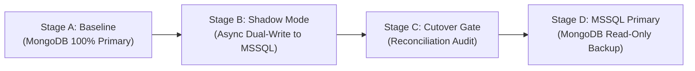

# WATCHHUB — PHASE 2 REVISED EXECUTION PLAN & SAFETY SPECIFICATION
**Pre-Initialization Architectural & Operational Execution Blueprint**

- **Project**: WatchHub — Luxury Horology E-Commerce & Enterprise Management Platform
- **Execution Gate**: PHASE 2 APPROVAL & PREPARATION GATE (STRICTLY READ-ONLY)
- **Target Database**: Microsoft SQL Server 2025 Standard Developer Edition (Host: `127.0.0.1:1433`)
- **ORM / Migrator**: Prisma ORM (v6.19.x)
- **Current Runtime**: Node.js + Express.js + Mongoose (Active Source of Truth)
- **Target Runtime**: Node.js + Express.js + Microsoft SQL Server + Prisma Client
- **Revision Date**: November 19, 2026
- **Status**: **REVISED & SAFETY REVIEWED — AWAITING EXPLICIT USER APPROVAL (NO MIGRATIONS RUN)**

---

## 1. Executive Control & Strict Execution Boundaries

In strict compliance with the **SAFETY REVIEW MANDATE**:
* **NO database creation (`CREATE DATABASE WatchHubDB`) has been executed.**
* **NO Prisma migrations (`prisma db push`, `prisma migrate dev`, `prisma migrate deploy`) have been executed.**
* **NO schema pushes, destructive SQL commands, or MongoDB/Mongoose deletions have been executed.**
* **Phase 1 security hardening, JWT signature validation, RBAC enforcement, and 800-line modularizations remain 100% intact.**
* **All findings formally deferred to Phase 2 (HD-007, HD-008, HD-009, HD-010, HD-012) are fully planned for migration.**
* **Planning approval must NEVER be treated as execution approval. Separate explicit approvals are required for Stage 1 and Stage 2.**

---

## 2. Technical Prerequisites & Compatibility Corrections

### 2.1 Prisma SQL Server Connector & Authentication Architecture
* **Original Defect Identified**: The initial plan proposed:
  ```env
  DATABASE_URL="sqlserver://localhost:1433;database=WatchHubDB;integratedSecurity=true;trustServerCertificate=true"
  ```
* **Technical Reality**: Prisma's underlying Rust Query Engine (`tiberius` TDS protocol driver) does **NOT** support Windows Integrated Authentication (`integratedSecurity=true` via SSPI/Kerberos/NTLM). Attempting to use this parameter results in connection failures.
* **Mandatory Architectural Correction**:
  1. SQL Server must be configured with **Mixed Mode Authentication** (SQL Server and Windows Authentication mode).
  2. A dedicated least-privilege service login (e.g., `watchhub_app`) must be created on the SQL Server instance with `db_owner` permissions on `WatchHubDB`.
  3. The supported, secure connection string format is:
     ```env
     DATABASE_URL="sqlserver://127.0.0.1:1433;database=WatchHubDB;user=${DB_USER};password=${DB_PASSWORD};encrypt=true;trustServerCertificate=true"
     ```
  4. Credentials must be injected strictly via `server/.env` (which is 100% untracked in Git); zero credentials in source files.

### 2.2 SQL Server 2025 TLS/SSL Handshake Compatibility
* Microsoft SQL Server 2025 enforces TLS encryption by default.
* The parameters `encrypt=true` and `trustServerCertificate=true` are strictly required to ensure proper cryptographic handshake with local development certificates without connection aborts.

### 2.3 Long-Term Schema Management Decision: `prisma migrate` vs `prisma db push`
* **Comparative Assessment**:
  - `prisma db push`: Ephemeral, non-versioned schema synchronization. Bypasses migration files, cannot be reviewed in pull requests, lacks execution history in `_prisma_migrations`, and cannot run custom SQL data migrations or data preservation steps.
  - `prisma migrate dev` / `prisma migrate deploy`: Industry standard for enterprise production systems. Generates timestamped, version-controlled `.sql` files in `prisma/migrations/`, maintains migration checksums in the `_prisma_migrations` audit table, supports automated CI/CD deployment pipelines, and enables predictable rollbacks.
* **Formal Decision**:
  - **`prisma migrate` is formally designated as the long-term schema management methodology for WatchHub.**
  - `prisma db push` is strictly prohibited in production and staging environments.
  - Initial migration will be initialized via:
    ```bash
    npx prisma migrate dev --name init_watchhub_mssql --schema=server/prisma/schema.prisma
    ```
    *(To be executed only upon receiving explicit Stage 2 user approval).*

---

## 3. Database Design & Relational Model Mapping

The target schema defined in [`server/prisma/schema.prisma`](file:///c:/Users/shrey/OneDrive/Desktop/watchHub/server/prisma/schema.prisma) contains **23 normalized relational entities** (22 domain models + 1 security audit log model):

```
+------------------------------------+------------------------------------------+----------------------------------------------+
| Existing Mongoose / In-Memory      | Target Prisma MSSQL Model(s)            | Key Structural Enhancements                  |
+------------------------------------+------------------------------------------+----------------------------------------------+
| User.js (embedded addresses)       | User, Address, Role, UserRole            | Normalized address & role RBAC tables        |
| Product.js (embedded variants)     | Product, Brand, Category, ProductImage   | Normalized brands, categories & image assets |
| Order.js (embedded items)          | Order, OrderItem                         | Normalized order lines with FK to Products   |
| Payment.js                         | Payment                                  | Linked to Orders with decimal precision      |
| LocationHistory.js                 | DeliveryLocationPing                     | Relational FK to Delivery & Rider User       |
| OtpVerification.js                 | OTPVerification                          | Normalized OTP ledger with purpose tracking  |
| AuditLog.js                        | AuditLog                                 | Relational FK to performing User             |
| In-Memory INVENTORY_DATABASE       | Warehouse, Inventory, StockTransaction   | Warehouse multi-vault ledger with audit trail|
| In-Memory SHIPMENTS & PARTNERS     | Delivery, DeliveryLocationPing           | Live dispatch tracking with OTP handover     |
| In-Memory SUPPORT_TICKETS & STATS  | SupportTicket, SupportMessage            | Conversation thread with internal notes      |
| In-Memory ACTIVE_COUPONS dict      | Coupon, CouponUsage                      | Configurable limits, caps, and dates in DB   |
+------------------------------------+------------------------------------------+----------------------------------------------+
```

### 3.1 Referential Integrity & Cascade Cycle Resolution
SQL Server Error 1785 (multiple cascade paths causing ambiguous cycles) has been eliminated in `schema.prisma` by enforcing:
```prisma
onDelete: NoAction
onUpdate: NoAction
```
on all secondary relationship paths (`StockTransactions.performedBy`, `Orders.customer`, `Orders.shippingAddress`, `Deliveries.order`, `Deliveries.assignedRider`, `SupportTickets.customer`, `SupportTickets.order`, `SupportMessages.sender`).

---

## 4. Dual-Stack Source-of-Truth & Transition Governance

To prevent data corruption, race conditions, or split-brain discrepancies during migration, the system strictly enforces the **4-Stage Dual-Stack Transition Lifecycle**:



1. **Stage A — Baseline (Pre-Migration)**:
   - Reads: MongoDB / In-Memory Services (100% authoritative).
   - Writes: MongoDB / In-Memory Services (100% authoritative).
   - MSSQL: Offline / Schema provisioned only.
2. **Stage B — Dual-Write Shadow Mode**:
   - Reads: MongoDB (Authoritative).
   - Writes: Primary write to MongoDB; secondary write to MSSQL via asynchronous try-catch shadow logger. Any MSSQL write failure is logged to `audit_phase_2/shadow_errors.log` without failing the user's HTTP request.
3. **Stage C — Cutover Reconciliation Gate**:
   - Automated script runs bidirectional record counts and referential integrity queries.
   - Requirement: Discrepancy = 0 across all 23 entities.
4. **Stage D — MSSQL Primary Promotion**:
   - Set `DB_ADAPTER="prisma"` in `server/.env`.
   - Reads: MSSQL (100% authoritative).
   - Writes: MSSQL (100% authoritative).
   - MongoDB: Archived as immutable pre-migration snapshot.

---

## 5. Pre-Migration Snapshot & Backup Verification

Prior to any write operations to `WatchHubDB`:
1. Execute `server/scripts/backup_mongodb_snapshot.js` exporting `users`, `products`, `orders`, and `payments` to `server/backups/snapshot_pre_phase2/`.
2. Compute and record SHA-256 integrity checksums in `manifest.json`.
3. Perform dry-run restore into temporary namespace `mongodb://localhost:27017/WatchHub_Backup_Verification`.
4. Validate that imported record counts match the manifest with **100.0% precision** before proceeding.

---

## 6. Topological Data Migration & Idempotent Seeding

### 6.1 Topological Execution Sequence
To satisfy foreign key dependencies, data migration and seeding proceed strictly in topological order:
1. `Roles` & `Permissions` ➔ `RolePermissions`
2. `Users` ➔ `UserRoles`, `Addresses`
3. `Categories` & `Brands`
4. `Warehouses`
5. `Products` ➔ `ProductImages`
6. `Inventory` ➔ `StockTransactions`
7. `Coupons`
8. `Orders` ➔ `OrderItems`
9. `Payments`
10. `Deliveries` ➔ `DeliveryLocationPings`, `DeliveryAttempts`
11. `SupportTickets` ➔ `SupportMessages`
12. `OTPVerifications`, `AuditLogs`

### 6.2 Idempotent Seeding Architecture
All seed scripts utilize `upsert` semantics based on natural unique keys:
- Roles: `upsert({ where: { roleName } })`
- Permissions: `upsert({ where: { permissionCode } })`
- Users: `upsert({ where: { email } })`
- Brands & Categories: `upsert({ where: { slug } })`
- Products: `upsert({ where: { sku } })`
- Coupons: `upsert({ where: { code } })`
- Warehouses: `upsert({ where: { warehouseCode } })`

Re-running seed scripts multiple times produces identical state with zero duplicate key exceptions.

---

## 7. Post-Migration Verification & Reconciliation Protocols

### 7.1 Record Count Reconciliation
```sql
SELECT 'Users' AS Entity, COUNT(*) AS MssqlCount FROM Users
UNION ALL SELECT 'Products', COUNT(*) FROM Products
UNION ALL SELECT 'Orders', COUNT(*) FROM Orders
UNION ALL SELECT 'Payments', COUNT(*) FROM Payments
UNION ALL SELECT 'Coupons', COUNT(*) FROM Coupons;
```
*Gate Criterion*: Discrepancy between MongoDB source count and MSSQL target count must equal **0**.

### 7.2 Referential Integrity Anti-Join Checks
Execute the 7 orphan-detection queries defined in `PHASE_2_DATA_MIGRATION_PLAN.md`.
*Gate Criterion*: All queries must return **0 orphaned records**.

### 7.3 API Response Contract Invariance
- All endpoints (`/api/auth/*`, `/api/products/*`, `/api/dashboard/*`, `/api/inventory/*`, `/api/delivery/*`, `/api/payments/*`, `/api/support/*`) must return the exact same JSON format:
  ```json
  { "status": "success", "data": { ... } }
  ```
- HTTP status codes (200, 201, 400, 401, 403, 404) and error messages remain identical.
- RBAC middleware (`authenticate`, `authorizeRoles`) remains untouched.

---

## 8. Staged Execution Gates & Approval Requirements

Execution is strictly segregated into independent stages requiring explicit user approvals:

```
+-------------------------------------------------------------------------------+
| STAGE 1 GATE: Database Provisioning & Authentication Setup                    |
| Requires: Explicit User Approval for Stage 1                                 |
| Actions: Enable SQL Server Mixed Mode -> Create WatchHubDB -> Create Service   |
|          Login -> Set DATABASE_URL in server/.env -> Verify Connection.       |
| Verification: sqlcmd confirms WatchHubDB online; zero Prisma migrations run.  |
+-------------------------------------------------------------------------------+
                                      │
                                      ▼
+-------------------------------------------------------------------------------+
| STAGE 2 GATE: Prisma Migration & Idempotent Seeding                           |
| Requires: Explicit User Approval for Stage 2                                 |
| Actions: Execute backup_mongodb_snapshot.js -> Run prisma migrate dev ->      |
|          Generate Prisma Client -> Execute idempotent seeders.                |
| Verification: 23 tables created; reconciliation queries return 0 discrepancy. |
+-------------------------------------------------------------------------------+
                                      │
                                      ▼
+-------------------------------------------------------------------------------+
| STAGE 3 GATE: Application Cutover & Verification                              |
| Requires: Explicit User Approval for Stage 3                                 |
| Actions: Implement prisma.js -> Switch controllers to Prisma ->               |
|          Run 34 backend regression tests -> Run 31 security probes.           |
| Verification: 100% test pass rate; client build passes in < 12s.             |
+-------------------------------------------------------------------------------+
```

---

## 9. Final Safety Stop Condition

**EXECUTION IS FULLY STOPPED.**

No database has been created.  
No migrations have been run.  
No application runtime queries have been modified.  
No Git commits have been created.  

The platform is safely prepared. Awaiting your separate, explicit instructions to begin **Stage 1 (Database Provisioning & Authentication Setup)**.
