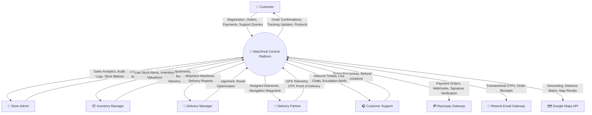
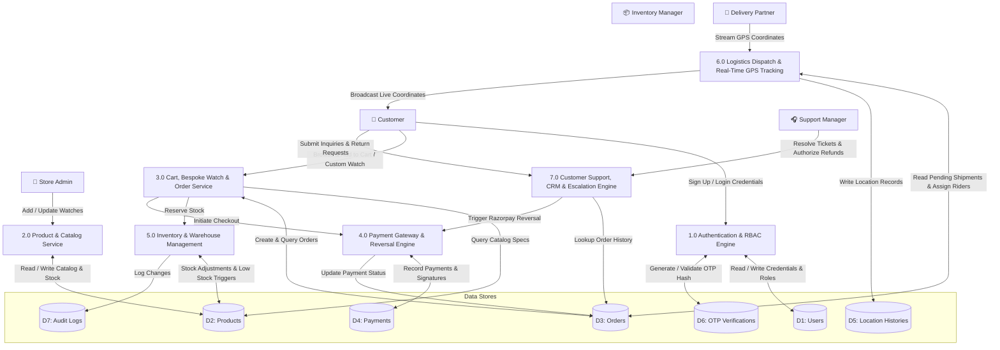
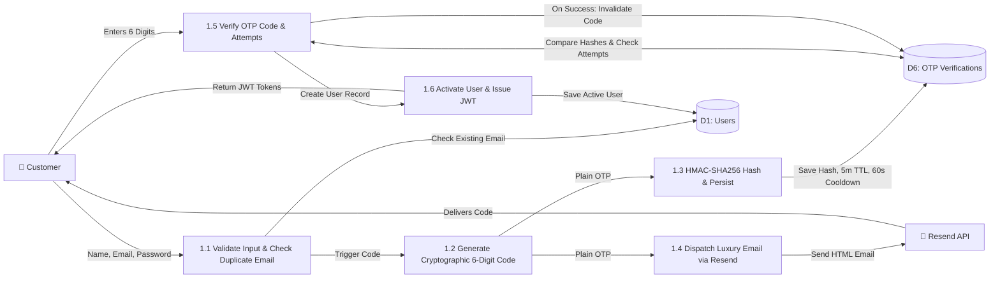
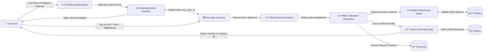
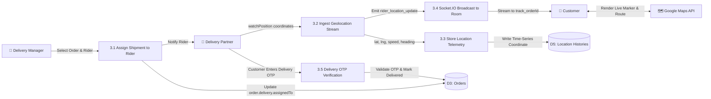

# WatchHub — Data Flow Diagrams (DFD)

This document provides complete multi-level Data Flow Diagrams (DFD Levels 0, 1, and 2) modeling the movement, transformation, and storage of data across the **WatchHub Luxury Watch E-Commerce & Management Platform**.

---

## 1. DFD Level 0 — System Context Diagram

---

## 2. DFD Level 1 — Functional Decomposition Diagram

---

## 3. DFD Level 2 — Detailed Subsystem Data Flows

### 3.1 DFD 2.1: Customer Registration & Resend Email OTP Verification

### 3.2 DFD 2.2: Timepiece Purchase, Razorpay Checkout & Stock Deduction

### 3.3 DFD 2.3: Delivery Assignment & Real-Time GPS Tracking

