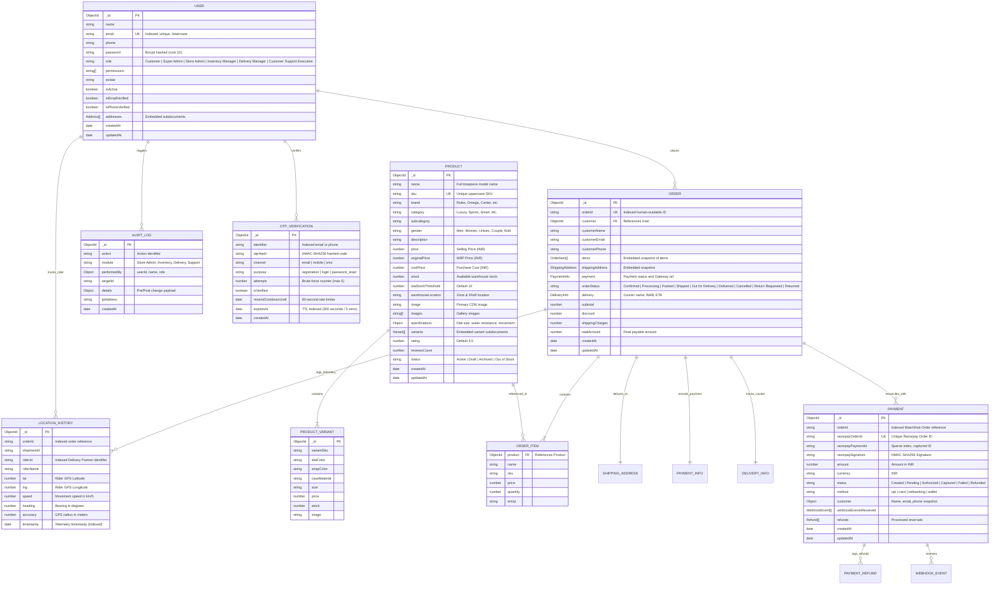

# WatchHub — Entity-Relationship (ER) Diagram & Database Architecture

This document provides a comprehensive specification of the MongoDB database schema, entity relationships, embedded document patterns, and indexing strategies utilized across the **WatchHub Luxury Watch E-Commerce & Management Platform**.

---

## 1. Complete Mermaid ER Diagram



---

## 2. Entity Schema Specifications

### 2.1 Collection: `users`
- **Purpose**: Stores authentication credentials, assigned role permissions, customer addresses, and verification states.
- **Primary Key**: `_id` (`ObjectId`)
- **Key Fields**:
  - `email` (`String`, Unique, Lowercase, Indexed)
  - `password` (`String`, Bcrypt hashed with salt factor 10)
  - `role` (`String`, Enum: `Customer`, `Super Admin`, `Store Admin`, `Inventory Manager`, `Delivery Manager`, `Customer Support Executive`, `Delivery Partner`)
  - `isEmailVerified` (`Boolean`, default: `false`)
  - `isPhoneVerified` (`Boolean`, default: `false`)
  - `addresses` (`Array<AddressSchema>`): Embedded subdocuments storing street, apartment, city, state, pincode, coordinates (`lat`, `lng`), and `isDefault` status.

### 2.2 Collection: `products`
- **Purpose**: Represents the luxury timepiece catalog, pricing, warehouse inventory allocation, and technical horology specifications.
- **Primary Key**: `_id` (`ObjectId`)
- **Key Fields**:
  - `sku` (`String`, Unique, Uppercase, Indexed)
  - `name` (`String`, Required, Trimmed)
  - `brand` (`String`, Required, Indexed)
  - `category` (`String`, e.g., "Luxury", "Chronograph", "Diver", "Dress")
  - `price` (`Number`, Min: 0)
  - `costPrice` (`Number`, Unit acquisition cost for margin reports)
  - `stock` (`Number`, Live warehouse inventory balance)
  - `lowStockThreshold` (`Number`, Default 10 for automated reorder alerts)
  - `specifications` (`Object`): Dial size, case material, strap material, movement type, water resistance.
  - `variants` (`Array<VariantSchema>`): Embedded SKU variants for specific dial/strap combinations.

### 2.3 Collection: `orders`
- **Purpose**: Captures customer order transactions, immutable item snapshots, delivery addresses, and fulfillment progress.
- **Primary Key**: `_id` (`ObjectId`)
- **Key Fields**:
  - `orderId` (`String`, Unique, Indexed, e.g., `WH-ORD-9024`)
  - `customer` (`ObjectId`, Ref: `User`)
  - `items` (`Array`): Snapshot containing `product` ref, `name`, `sku`, `price`, `quantity`.
  - `shippingAddress` (`Object`): Customer address snapshot at the moment of checkout.
  - `payment` (`Object`): Tracks gateway status (`Created`, `Pending`, `Captured`, `Refunded`), Razorpay Order ID, and Payment ID.
  - `orderStatus` (`String`, Enum: `Confirmed`, `Processing`, `Packed`, `Shipped`, `Out for Delivery`, `Delivered`, `Cancelled`, `Return Requested`, `Returned`).
  - `delivery` (`Object`): Courier partner (`BlueDart`, `Delhivery`), AWB tracking ID, assigned rider ref, and estimated delivery timestamp.

### 2.4 Collection: `payments`
- **Purpose**: Financial ledger records tracking Razorpay payment gateway transactions, webhook receipts, and refunds.
- **Primary Key**: `_id` (`ObjectId`)
- **Key Fields**:
  - `orderId` (`String`, Indexed)
  - `razorpayOrderId` (`String`, Unique, Indexed)
  - `razorpayPaymentId` (`String`, Indexed, Sparse)
  - `razorpaySignature` (`String`, HMAC-SHA256 signature for verification)
  - `amount` (`Number`, In INR currency)
  - `status` (`String`, Enum: `Created`, `Pending`, `Authorized`, `Captured`, `Failed`, `Refunded`, `Partially Refunded`)
  - `webhookEventsReceived` (`Array`): Audit log of raw webhook payloads received from Razorpay.
  - `refunds` (`Array`): List of refund reversals processed through Razorpay API.

### 2.5 Collection: `locationhistories`
- **Purpose**: Time-series telemetry tracking real-time GPS coordinates of delivery partners during active deliveries.
- **Primary Key**: `_id` (`ObjectId`)
- **Key Fields**:
  - `orderId` (`String`, Indexed)
  - `riderId` (`String`, Indexed)
  - `lat` (`Number`, Latitude)
  - `lng` (`Number`, Longitude)
  - `speed` (`Number`, km/h)
  - `heading` (`Number`, direction in degrees)
  - `timestamp` (`Date`, Indexed)

### 2.6 Collection: `otpverifications`
- **Purpose**: Cryptographic store for one-time passwords used during email and mobile authentication.
- **Primary Key**: `_id` (`ObjectId`)
- **Key Fields**:
  - `identifier` (`String`, Indexed, email or phone number in lowercase)
  - `otpHash` (`String`, HMAC-SHA256 digest of identifier + secret salt + OTP)
  - `channel` (`String`, Enum: `email`, `mobile`, `sms`)
  - `purpose` (`String`, Enum: `registration`, `login`, `password_reset`, `sensitive_action`)
  - `attempts` (`Number`, default: 0, max: 5)
  - `resendCooldownUntil` (`Date`, 60-second cooldown limiter)
  - `expiresAt` (`Date`, Indexed with `{ expires: 300 }` for automatic 5-minute MongoDB TTL purge)

### 2.7 Collection: `auditlogs`
- **Purpose**: System-wide administrative action tracking for security, compliance, and dispute resolution.
- **Primary Key**: `_id` (`ObjectId`)
- **Key Fields**:
  - `action` (`String`, e.g., `STOCK_ADJUSTMENT`, `REFUND_AUTHORIZED`, `USER_ROLE_UPDATED`)
  - `module` (`String`, `Store Admin`, `Inventory`, `Delivery`, `Support`)
  - `performedBy` (`Object`: `userId`, `name`, `role`)
  - `targetId` (`String`, affected document ID)
  - `details` (`Mixed`, before/after delta)
  - `ipAddress` (`String`)

---

## 3. Relationships & Cardinality

| Parent Entity | Child Entity | Cardinality | Implementation Style | Rationale |
|---|---|---|---|---|
| `User` | `Order` | 1 : N | Referenced (`customer: ObjectId`) | Allows scalable order history without exceeding 16MB document limits. |
| `User` | `Address` | 1 : N | Embedded (`addresses: []`) | Addresses are tightly coupled to the user profile and rarely exceed 5 per customer. |
| `Product` | `Variant` | 1 : N | Embedded (`variants: []`) | Variants belong exclusively to their parent timepiece. |
| `Order` | `OrderItem` | 1 : N | Embedded (`items: []`) | Price and SKU must remain immutable historical snapshots even if product catalog changes. |
| `Order` | `Payment` | 1 : 1 (or 1 : N for re-attempts) | Referenced (`orderId`) | Enables separate financial reconciliation and webhook ingestion. |
| `Order` | `LocationHistory` | 1 : N | Referenced (`orderId`) | High-frequency GPS updates (every 5–10s) must not cause write-lock contention on the order document. |
| `User` | `OtpVerification` | 1 : N | Referenced (`identifier`) | OTP records are short-lived (5 min TTL) and independently indexed. |

---

## 4. Indexing Strategy & Performance Optimization

```javascript
// 1. User Collection
db.users.createIndex({ email: 1 }, { unique: true });
db.users.createIndex({ role: 1 });

// 2. Product Collection
db.products.createIndex({ sku: 1 }, { unique: true });
db.products.createIndex({ brand: 1, category: 1 });
db.products.createIndex({ price: 1 });
db.products.createIndex({ name: "text", description: "text" });

// 3. Order Collection
db.orders.createIndex({ orderId: 1 }, { unique: true });
db.orders.createIndex({ customer: 1, createdAt: -1 });
db.orders.createIndex({ "payment.razorpayOrderId": 1 });
db.orders.createIndex({ orderStatus: 1 });

// 4. Payment Collection
db.payments.createIndex({ razorpayOrderId: 1 }, { unique: true });
db.payments.createIndex({ razorpayPaymentId: 1 }, { sparse: true });
db.payments.createIndex({ orderId: 1 });

// 5. OTP Verification Collection (Automatic TTL Invalidation)
db.otpverifications.createIndex({ identifier: 1, purpose: 1 });
db.otpverifications.createIndex({ expiresAt: 1 }, { expireAfterSeconds: 0 });

// 6. Location Telemetry Collection
db.locationhistories.createIndex({ orderId: 1, timestamp: -1 });
db.locationhistories.createIndex({ riderId: 1, timestamp: -1 });
```
