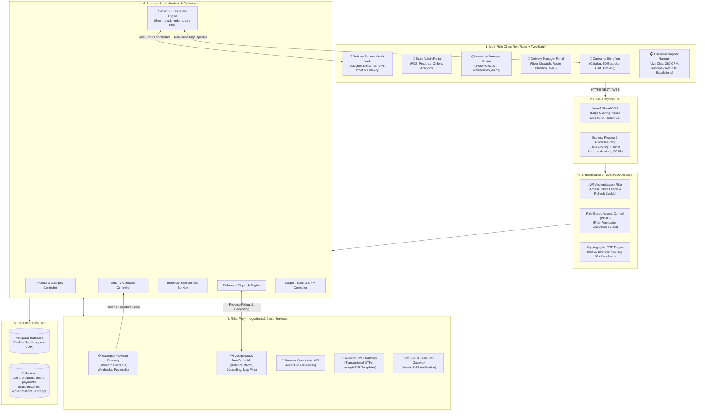
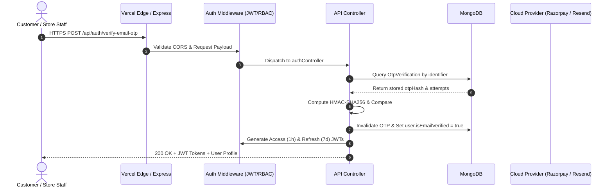

# WatchHub — High-Level System Architecture

This document details the multi-tier architectural blueprint of the **WatchHub Luxury Watch E-Commerce & Management Platform**, highlighting component interactions, communication protocols, security boundaries, and external cloud service integrations.

---

## 1. Architectural Diagram

---

## 2. Tier Breakdown & Technology Roles

### 2.1 Client Presentation Tier (Frontend)
- **Framework**: React 18 + TypeScript bundled with Vite.
- **Styling**: Tailwind CSS with custom luxury Dark Navy (`#070918`, `#091426`), Gold (`#E7B43F`), and Cyan (`#00D9E8`) themes.
- **State Management**: React Context API (`AuthContext`, `CartContext`, `WishlistContext`, `OrderContext`).
- **Charting & Data Visualization**: Recharts (Interactive Donut charts, Weekly Area volume curves, CSAT Line charts).
- **Icons**: Lucide React.
- **Navigation**: React Router DOM v6 with role-guarded routing (`RoleProtectedRoute`).

### 2.2 Server Application Tier (Backend)
- **Runtime**: Node.js v20+ with Express.js framework.
- **Security Middlewares**:
  - `helmet`: Applies 15+ secure HTTP headers (HSTS, Content Security Policy, XSS Protection).
  - `cors`: Strict origin validation allowing requests only from verified client domains.
  - `cookieParser`: Handles secure HTTP-only refresh tokens.
  - `morgan`: Structured HTTP request logging.
- **Real-Time Communication**: Socket.IO server mounted on the Node HTTP server. Allows delivery partners to stream GPS telemetry directly to customers tracking parcels via room-based events (`track_<orderId>`).

### 2.3 Data Storage Tier (Database)
- **Database Engine**: MongoDB.
- **Object Data Modeling (ODM)**: Mongoose v8.
- **High-Performance Patterns**:
  - Embedded subdocuments for atomic line items (`order.items`) and address lists (`user.addresses`).
  - Referenced models for high-frequency writes (`locationhistories`) and independent audit trails (`payments`).
  - Automated TTL cleanup (`otpverifications.expiresAt` with `expireAfterSeconds: 0`).

---

## 3. Communication Protocols & Security Boundaries

---

## 4. Socket.IO Real-Time Architecture

The platform incorporates real-time WebSockets to bridge the physical logistics and customer portals:
1. **Room Channel Structure**: `track_${orderId}`.
2. **Telemetry Flow**:
   - The Delivery Partner triggers the `navigator.geolocation.watchPosition` API.
   - Coordinates (`lat`, `lng`, `speed`, `heading`) are emitted to the server via event `rider_location`.
   - The server validates the rider's active assignment, persists the record into `LocationHistory`, and broadcasts the event `rider_location_update` directly to the customer's open tracking room.
   - The customer's Google Map marker smoothly animates without requiring full page polling.
