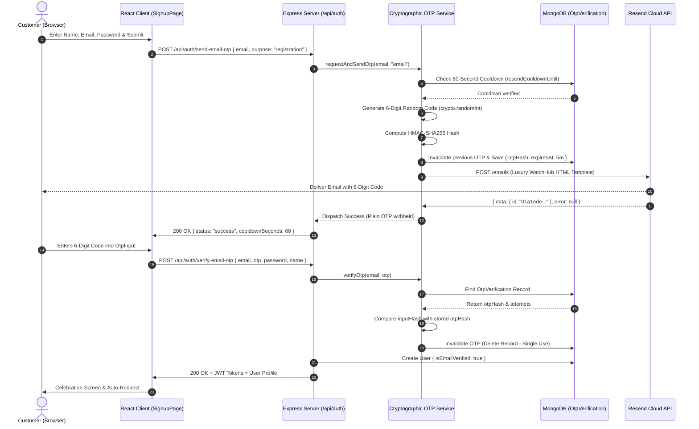
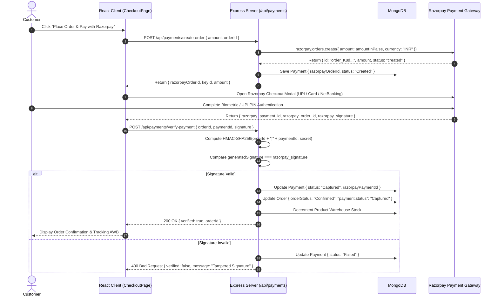
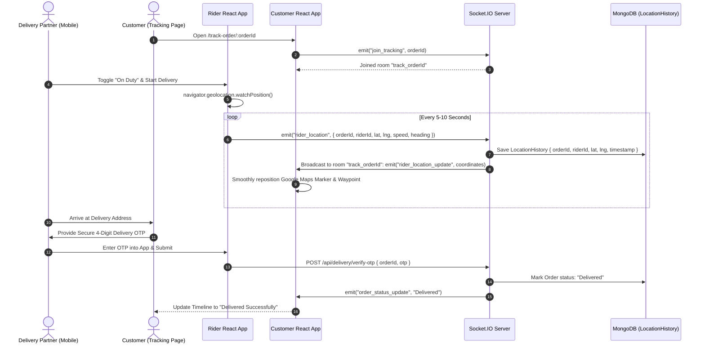
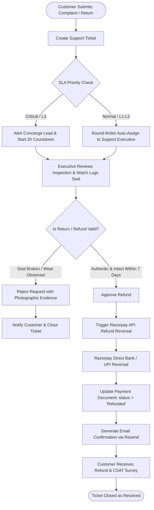

# WatchHub — Unified Modeling Language (UML) Diagrams

This document contains the complete formal UML behavioral and structural models for the **WatchHub Luxury Watch E-Commerce & Management Platform**, modeled with Mermaid syntax.

---

## 1. Overall System Use Case Diagram

```mermaid
flowchart LR
    subgraph Actors["System Actors"]
        Customer["👤 Customer"]
        Admin["🏪 Store Admin"]
        InvMgr["📦 Inventory Manager"]
        DelMgr["🚚 Delivery Manager"]
        DelRider["🛵 Delivery Partner"]
        Support["🎧 Customer Support"]
    end

    subgraph CustomerUseCases["Customer Use Cases"]
        UC1["Browse & Filter Watches"]
        UC2["Design Bespoke Beaded Watch"]
        UC3["Manage Wishlist & Cart"]
        UC4["Checkout & Pay via Razorpay"]
        UC5["Track Live Shipment & GPS"]
        UC6["Request Return & Refund"]
        UC7["Live Concierge Chat"]
    end

    subgraph AdminUseCases["Store Admin Use Cases"]
        UC8["Manage Timepiece Products & SKUs"]
        UC9["POS Terminal Sales"]
        UC10["Manage Discounts & Offers"]
        UC11["View Store Analytics & Revenue"]
    end

    subgraph InventoryUseCases["Inventory Manager Use Cases"]
        UC12["Monitor Warehouse Stock Levels"]
        UC13["Stock Adjustments & Movements"]
        UC14["Low-Stock Reorder Triggers"]
        UC15["Purchase Requests"]
    end

    subgraph DeliveryUseCases["Logistics Use Cases"]
        UC16["Assign Deliveries to Riders"]
        UC17["Route Planning & Geocoding"]
        UC18["Manage Returns & Reverse Pickups"]
        UC19["Stream Live Rider GPS Coordinates"]
        UC20["Verify Customer Delivery OTP"]
    end

    subgraph SupportUseCases["Support Use Cases"]
        UC21["Triage Tickets & SLA Overrules"]
        UC22["Direct Concierge Messaging"]
        UC23["Authorize Razorpay Refunds"]
        UC24["Manage Knowledge Base Articles"]
    end

    Customer --> UC1
    Customer --> UC2
    Customer --> UC3
    Customer --> UC4
    Customer --> UC5
    Customer --> UC6
    Customer --> UC7

    Admin --> UC8
    Admin --> UC9
    Admin --> UC10
    Admin --> UC11

    InvMgr --> UC12
    InvMgr --> UC13
    InvMgr --> UC14
    InvMgr --> UC15

    DelMgr --> UC16
    DelMgr --> UC17
    DelMgr --> UC18

    DelRider --> UC19
    DelRider --> UC20

    Support --> UC21
    Support --> UC22
    Support --> UC23
    Support --> UC24
```

---

## 2. Sequence Diagram: Resend Email OTP Verification

---

## 3. Sequence Diagram: Razorpay Payment & Verification

---

## 4. Sequence Diagram: Live GPS Delivery Tracking & Socket.IO Telemetry

---

## 5. Activity Diagram: Customer Support Ticket Resolution & Razorpay Refund

